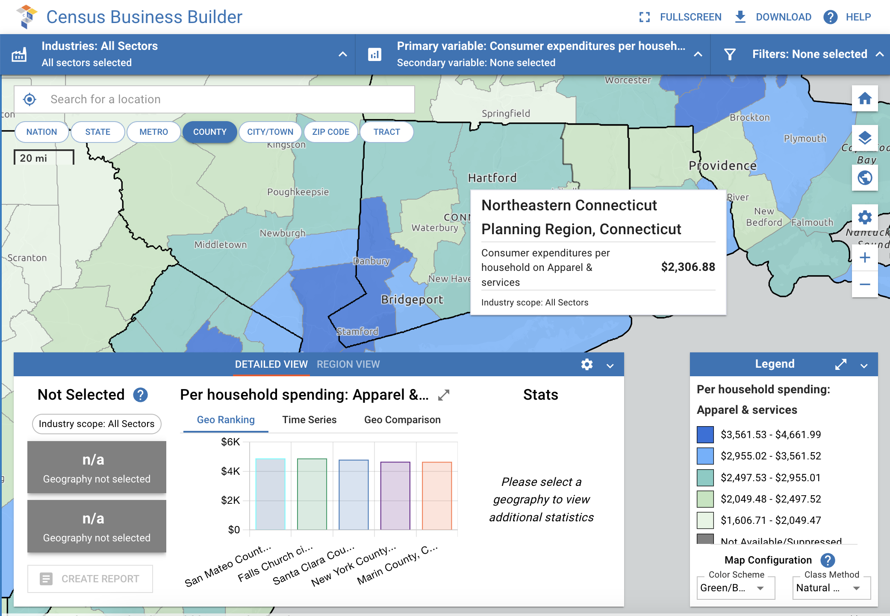
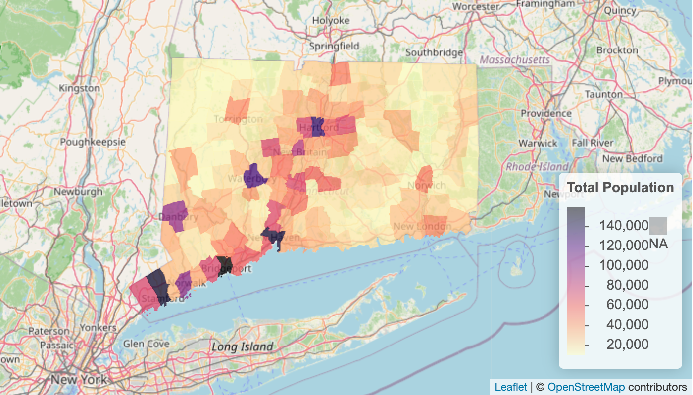
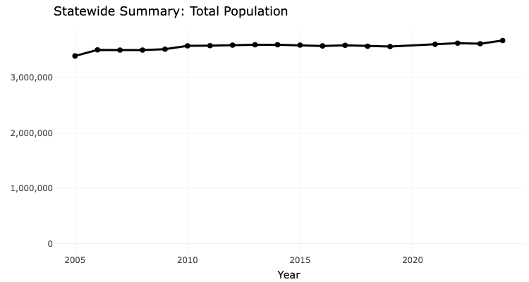

## Introduction

> The Connecticut (CT) Mirror is a Pulitzer-prize winning non-profit newspaper based in Hartford, Connecticut [@pazniokas_ct_2026]. Through careful reporting of issues spanning immigration, economics, criminal justice, and public health, the CT Mirror fills a crucial gap in state policy reporting in Connecticut. Beat reporters frequently integrate Connecticut census data in their reporting to provide context on housing trends, education outcomes, and demographic statistics. However, CT Mirror reporters lack the technical background to make full use of this rich dataset. According to CT Mirror reporter Angela Eichhorst, reporters “want to be able to look at historical trends and also compare town by town but they don't know how to use the US 5 year census data estimates.” Furthermore some “reporters don't necessarily know all of the data that is available to them to look at” [@angela_eichhorst_connecticut_2026]. Therefore, the goals of the CT Mirror Census Data Dashboard are twofold: first, to provide a user-friendly simplified tool to engage with historical and town-by-town census data, and second, to introduce reporters to the full scope of census data available. 

### Relevant work

> Due to the high-visibility and government sponsorship of the U.S. Census, there already exist several modes of access to Census data. The Census Bureau publishes their American Consumer Survey microdata as interactive and filterable spreadsheets, accessible on their website. However, effective use of these spreadsheets requires significant background knowledge on Census variables, and it is not accessible to the average user. Additionally, while the raw data is accessible from the interactive spreadsheets, there are no visualizations. 

{#fig-cbb}

> Alternatively, the Census Bureau publishes a data analytics tool called the Census Business Builder [@us_census_bureau_census_2026]. This dashboard, geared towards small business owners, visualizes census data across a variety of geographies, breaking it down by a primary and secondary variable as well as a demographic filter. @fig-cbb shows a screenshot of the Census Business Builder User-Interface with one primary variable selected at the county level. But while the Census Business Builder is comprehensive, it does not fit the specific needs of the CTMirror newsroom. The dashboard has a steep learning curve and is not intuitive for a non-technical user. Additionally, it is not built for a Connecticut-specific use case. The Census Business Builder has data on the state, county, and town level. Connecticut, however, doesn’t make legislative decisions on the county-level, making State and Town the only necessary geographies for this region [@angela_eichhorst_connecticut_2026]. Finally, the Census Business Builder does not provide historical time-series data. 

### Our contribution

> This paper presents a new user-friendly, interactive Census Data tool that is specifically tailored to the needs of reporters in Connecticut. Unlike existing Census data exploration tools, the Connecticut Mirror Data Dashboard delivers a time-series analysis of variable trends over time. Additionally, the final dashboard is streamlined to provide reporters with the most relevant information as quickly as possible, and leaving out details that would contribute to user confusion. 

## Data {#sec-data}
> The U.S. Census Bureau authors the American Community Survey (ACS), a publicly available data set used widely by the government (and other stakeholders) to understand citizens and make data-driven decisions. It comprises an ongoing survey started in 2005 to collect information about demographics, education, economics, housing, and more, from sampled households across the country [@us_census_bureau_american_2026]. About 3.5 million residential addresses are sampled yearly [@us_census_bureau_american_2026-1]. There are different types of ACS releases, including 1-Year Estimates, which contains 12-month data for areas with populations of 65,000+ individuals, and 5-Year Estimates, which merges 60-month data for areas of all population sizes [@us_census_bureau_american_2026-1].

> All ACS data covers four main categories: Social Characteristics, Housing Characteristics, Economic Characteristics, Demographic and Housing Estimates [@us_census_bureau_american_2026]. The ACS organizes its data as a tree. Concepts form branches and name a broad table topic, such as Median Household Income in the Past 12 Months. Each concept divides into subconcepts that break the topic down by categories, such as age group, race, or sex. The leaves are individual variables, each of which holds one estimate. The full ACS contains approximately 1,200 concepts and 28,500 subconcepts. 

{#fig-towns}

> For this project, we restrict our dataset to Connecticut. We keep only records for the state and its 169 towns. The geographic location and 2024 total population in these towns is displayed in @fig-towns. This restriction removes the national scope that makes the Census Bureau’s own tools hard to navigate and aligns the data with the geographic units that Connecticut policy uses. The trend of total population of Connecticut in over the last 19 years is represented by @fig-ts.  

{#fig-ts}

## Methods {#sec-methods}

> Methods: What did you actually do? What techniques or methods did you employ? What were the specifications for any statistical models you used? What software or packages did you use or develop?

## Results

> Results: What did you learn about the problem you identified in Section 1? This is where you put the tables, figures, and analytics by-products of your work.

## Conclusion

> Conclusion: What are the limitations of your work? What are some next steps that someone (either you or another research group) should consider in attempting to further your work? Remind us one last time about what you did.

### Limitations

### Future work

### Final thoughts

## Ethical statement {.appendix}

> Drawing on what you have learned about data science ethics in this class, discuss any ethical considerations in your project. For some projects, this statement could be quite short (one paragraph may suffice). For other projects, more detail may be needed (no more than 2 pages).
>
> Be expansive and creative in your thinking about **possible** ethical considerations. One way to do this assignment poorly would be to write a short statement asserting that there are no ethical considerations, only to have me think of several fairly obvious ones.

## Acknowledgements {.appendix}

> Were there any people or organizations who helped you that you would like to acknowledge? 

## References {.unnumbered}

:::{#refs}

:::