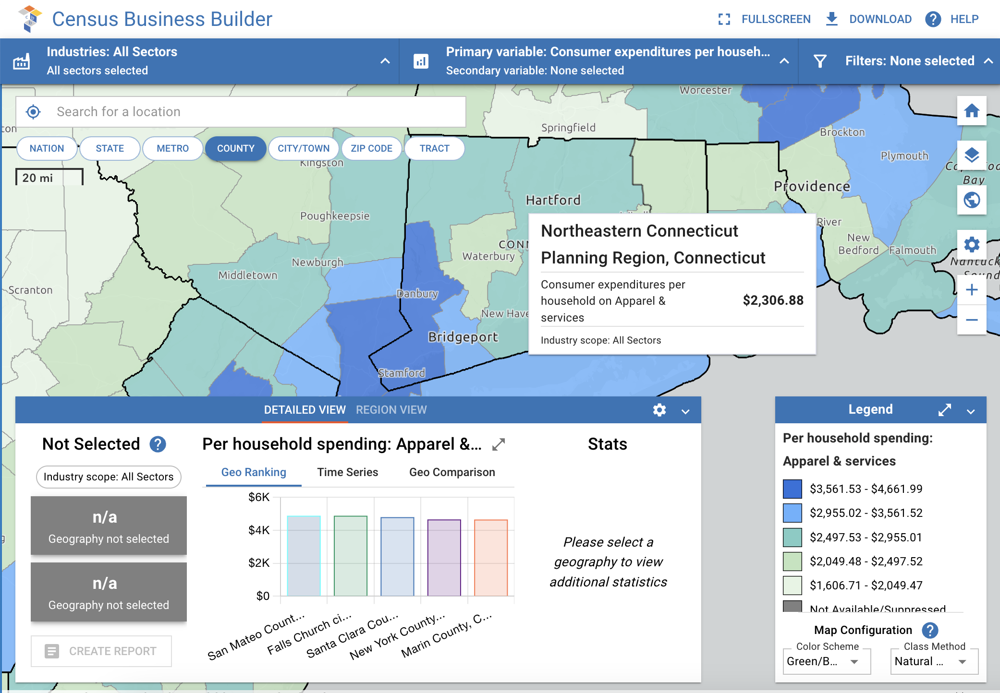
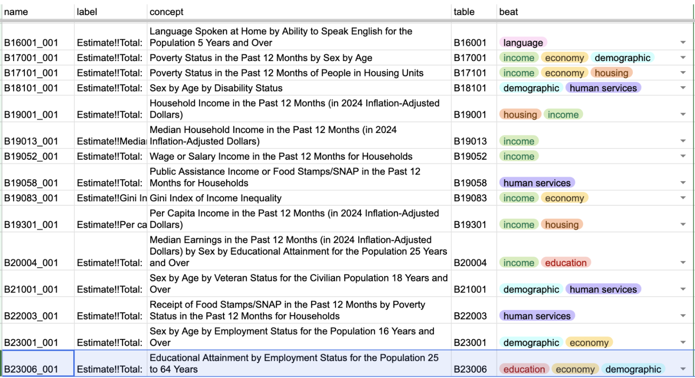

## Introduction

The Connecticut (CT) Mirror is a Pulitzer Prize-winning non-profit newspaper based in Hartford, Connecticut [@pazniokas_ct_2026]. Through careful reporting of issues spanning immigration, economics, criminal justice, and public health, the CT Mirror fills a crucial gap in state policy reporting in Connecticut. Beat reporters frequently integrate Connecticut census data in their reporting to provide context on housing trends, education outcomes, and demographic statistics. However, CT Mirror reporters lack the technical background to make full use of this rich dataset. In one article published in November, 2026, CT Mirror reporter Sasha Allen referenced two specific census demographic statistics—Hispanic or Latino Origin, and Receipt of Food Stamps—to provide context on voter turnout in the 2026 general election [@allen_ct_2026]. Throughout this paper, we will use these two census variables as examples to tie our work back to a real-life use case.

Though some census data is currently being integrated into CT Mirror reporting, not all reporters have the technical background to make full use of this rich dataset. According to CT Mirror reporter Angela Eichhorst, reporters “want to be able to look at historical trends and also compare town by town but they don't know how to use the US 5-year census data estimates.” Furthermore some “reporters don't necessarily know all of the data that is available to them to look at” [@angela_eichhorst_connecticut_2026]. Therefore, the goals of the CT Mirror Census Data Dashboard are twofold: first, to provide a user-friendly simplified tool to engage with historical and town-by-town census data, and second, to introduce reporters to the full scope of census data available. 

### Relevant work

Due to the high-visibility and government sponsorship of the U.S. Census, there already exist several modes of access to Census data. The Census Bureau publishes its American Consumer Survey microdata as interactive and filterable spreadsheets, accessible on its website. [@us_census_bureau_american_2026] However, effective use of these spreadsheets requires significant background knowledge on Census variables, and it is not accessible to the average user. Additionally, while the raw data is accessible from the interactive spreadsheets, there are no visualizations. 

Alternatively, the Census Bureau publishes a data analytics tool called the Census Business Builder [@us_census_bureau_census_2026]. This dashboard, geared towards small business owners, visualizes census data across a variety of geographies, breaking it down by a primary and secondary variable as well as a demographic filter. @fig-cbb shows a screenshot of the Census Business Builder user interface with one primary variable selected at the county level. But while the Census Business Builder is comprehensive, it does not fit the specific needs of the CTMirror newsroom. The dashboard has a steep learning curve and is not intuitive for a non-technical user. Additionally, it is not built for a Connecticut-specific use case. The Census Business Builder has data on the state, county, and town level. Connecticut, however, doesn’t make legislative decisions on the county level, making State and Town the only necessary geographies for this region [@angela_eichhorst_connecticut_2026]. Finally, the Census Business Builder does not provide historical time-series data. 

{#fig-cbb}

### Our Contribution

This paper presents a new user-friendly, interactive Census Data tool that is specifically tailored to the needs of reporters in Connecticut. Unlike existing Census data exploration tools, the Connecticut Mirror Data Dashboard delivers a time-series analysis of variable trends over time. Additionally, the final dashboard is streamlined to provide reporters with the most relevant information as quickly as possible, and leaving out details that would contribute to user confusion. 

## Data {#sec-data}

The U.S. Census Bureau authors the American Community Survey (ACS), a publicly available data set used widely by the government (and other stakeholders) to understand citizens and make data-driven decisions. It comprises an ongoing survey started in 2005 to collect information about demographics, education, economics, housing, and more, from sampled households across the country [@us_census_bureau_american_2026]. @fig-survey shows an example of the raw survey questions from 2026. About 3.5 million residential addresses are sampled yearly [@us_census_bureau_american_2026-1]. There are different types of ACS releases, including 1-Year Estimates, which contains 12-month data for areas with populations of 65,000+ individuals, and 5-Year Estimates, which merges 60-month data for areas of all population sizes [@us_census_bureau_american_2026-1].

![ Informational ACS survey sample from 2026 [@bureau_sample_nodate]. Question 5 asks the survey respondent about Hispanic/Latino origin, which corresponds to the census concept B03003.](images/survey-image.png){#fig-survey}

All ACS data covers four main categories: Social Characteristics, Housing Characteristics, Economic Characteristics, Demographic and Housing Estimates [@us_census_bureau_american_2026]. The ACS organizes its data as a tree (@fig-treediagram). Concepts form branches and name a broad table topic. Each concept divides into subconcepts that break the topic down by categories, such as age group, race, or sex. The leaves are individual variables, each of which holds one estimate. The full ACS contains approximately 1,200 concepts and 28,500 subconcepts. 

{#fig-treediagram}

## Methods {#sec-methods}

Our central goal in creating the Connecticut Mirror Data Dashboard is to balance _data accessibility_ with _data comprehensibility_. Census data is vast and hierarchically structured, and therefore requires technical domain knowledge to navigate. However, the core audience of the dashboard is non-technical reporters. We produce a streamlined user interface for accessing census variables without flattening or misrepresenting the data. We enact several methodological design choices in order to assist this accessibility-comprehensiveness balance. 

### Data Tagging and Curation

The full 5-Year ACS catalog holds thousands of concepts and subconcepts. These concepts are labeled with alphanumeric codes that are not meaningful in a reporting context. We first filter our dataset to only keep records for the 169 towns in Connecticut. This restriction removes the national scope that makes the Census Bureau’s own tools hard to navigate and aligns the data with the geographic units that Connecticut policy uses. We also removed all census concepts that exclusively dealt with Puerto Rico, which are irrelevant to Connecticut and simple to isolate by their labels. To ease filtering, we manually match all 1,200 concepts with one or multiple of 12 tags derived from CT Mirror reporting beats. For example, we code the concept “Educational Attainment by Employment Status for the Population 25 to 64 Years” with the “Education”, “Economy”, and “Demographic” beat tags (@fig-qual-tag).

{#fig-qual-tag}

Though qualitatively tagging assists in associating census concepts with their reporter beat, it does not reduce the sheer number of ACS concepts in each beat. High quantities of variables pose a technical challenge in terms of wait times for API calls, and make for an overwhelming visual user experience. We pare down the full 1,200 ACS concepts into a list of 59 “High Priority” concepts, ascertained in conversation with CT Mirror stakeholders to capture basic demographic statistics such as sex, race, age, and citizenship. We ensure each beat covered by the CT Mirror is served by at least three high-priority variables to provide breadth across subjects. 

Using our high-priority variable tags and the glossary of census concepts, we make successive API calls for each Connecticut town to cache the most important variables of interest. Data caching is the primary method for ensuring the dashboard has a fast response time. We also integrate our qualitative tagging and data cleaning into the dashboard to remain user-friendly and avoid complicated labels. 

### A Filterable Hierarchical Structure

ACS tables are structured as “trees” with multiple nested variable breakdowns. For example, variables on Household Type and Children are nested beneath the Receipt of SNAP Benefits variable. To wrangle this complex data hierarchy, we create a flat lookup table that describes the shape of the “tree,” with each leaf associated with its specific dimensions (@fig-table_dimensions in appendix). @fig-treediagram-methods displays the association between tree level and its dimension label for concept B22002. We drop parent totals and repeated-total rows, so each row in the lookup table corresponds to one leaf in the tree. This ensures that each row is a non-overlapping category that is safe to sum.

{#fig-treediagram-methods}

We then use a custom function to create human-readable labels corresponding with the original subconcept names. This wrangling allows us to create a sidebar with the ability to filter by dimension using dropdown menus (@fig-snap-dropdown). Additional custom functions use our lookup table to translate the user’s dropdown selections into the exact set of relevant leaves. Our dashboard then sums those leaves’ estimates into the count, percent, and denominator columns shown on the visualizations for each town or year.

{#fig-snap-dropdown}

### Aggregation Logic for Non-Additive Quantities 

The majority of the ACS census variables are raw counts, meaning they can be split into their individual leaves and added back together to create estimates for the desired dimensions. A “Percent of” filter also lets users reframe the denominator (for example, viewing “Male 15-17 years old” as a share out of the whole population, out of all men, or out of all 15-17 year olds). However, some variables take different forms, such as medians, means, per capita, aggregates, Gini inequality scores, and indexes. For non-additive variables, we display one line at a time instead of a sum in order to preserve the statistical meaning.

### Software

We produced code in R version 4.5.1. We used the packages `shiny` and `bslib` to construct an interactive website, `tidycensus` for API calls, `tigris` for shapefiles, and `leaflet` and `plotly` for mapping and charting.

## Results {#sec-results}

The main result of this project is the CT Mirror Census Data Dashboard. In this section, we show how beat coding reshapes the ACS for reporters. We then walk through each tab of the dashboard and the reporting problem it solves. Next, we reproduce the two statistics from our motivating article to show how a reporter uses the tool. Finally, we describe how we will evaluate the dashboard with CT Mirror reporters.

### Reorganizing the ACS for a Newsroom
Beat coding turns the ACS catalog into lists a reporter can browse. @fig-concepts-table shows two features of the reorganized data. First, the beats differ in size. Demographic, Race, Housing, and Economy each contain more than 400 concepts, while Language and Tech contain 31 each. This reflects what the ACS measures, not our coding. Second, the high-priority list shortens what a reporter sees: Human Services shows 6 concepts, not 92. Ten of the eleven reporter-facing beats have at least three high-priority concepts. Tech has none, so it appears in the beat menu only after a reporter fetches a Tech concept from the **Find Variables** tab. 

{#fig-concepts-table}

### Dashboard Overview 

The dashboard (@fig-dashboard-overview) has a shared sidebar, multiple tabs, and a placeholder tab for future features.

{#fig-dashboard-overview}

**Sidebar:** The reporter picks a beat and then a variable from searchable dropdowns. Each beat opens on a default variable; for example, the Human Services beat opens on SNAP receipt. Below these, the sidebar builds one filter per table dimension. A Percent of control sets the denominator. For example, with Male and Under 5 years selected, the reporter can choose among the share of everyone, the share of males who are under 5, and the share of under-5s who are male. Medians and indexes cannot be added up.

**Home:** This tab serves the first goal of the project: comparing towns and observing trends. A choropleth map that shades each area by its value displays the selected variable for all 169 towns. Hovering over a town shows the percentage with its count and total, which lets reporters tell a large share of a small town apart from a large share of a large city. Below the map, a line chart plots the same selection statewide from 2005 to 2024. 

**Find Variables:** This tab lists all 1,199 concepts with their beat and priority tags in a filterable table. Clicking **Make custom API call** on any row fetches that concept from the census API and adds it to the sidebar. Reporters can reach the whole catalog of variables, which helps this tab fulfill our second goal of showing reporters the full scope of what the ACS offers.

**Data:** This tab shows the town and statewide tables behind the current selection, with CSV downloads. A reporter can check a figure or send it to a graphics editor without leaving the dashboard. A fourth tab, **Advanced**, is a placeholder for future features, namely a comparative time series that is currently in progress.

### Application 
To test whether the dashboard supports real reporting, we reproduce the two statistics that CT Mirror reporter Sasha Allen uses for context on the voter turnout in the 2026 general election [@allen_ct_2026].

To understand the Hispanic/Latino demographic in CT, a reporter can select the Race beat and then Hispanic or Latino Origin (concept B03003) and display the percentages on the map (@fig-hispanic-map). Bridgeport (44.8%) and Hartford (44.5%) have the highest shares in the state. New Britain, East Hartford, Windham, Waterbury, and Meriden all exceed 38%. The median town, by contrast, is 6.8% Hispanic or Latino, and 120 of 169 towns fall below 10%. This concentration disappears at coarser geographies. The Census Bureau now reports Connecticut by nine planning regions, and averaging Bridgeport with its suburbs would hide the cities that matter most to a voter turnout story [@federal_register_change_2022].

{#fig-hispanic-map}

A reporter can also investigate SNAP receipt similarly: they can select the Human Services beat and open Receipt of Food Stamps/SNAP (concept B22002). Statewide, the share of households receiving SNAP more than doubles from 5.4% in 2005 to 12.0% in 2012, after the 2008 recession (@fig-snap-ts). It peaks at 13.1% in 2016, falls to 11.1% in 2019, and stays near 11.9% from 2021 to 2024. The map adds the local picture: in 2020-2024, receipt is highest in Hartford (37.2%), Waterbury (29.5%), and Windham (28.3%), and Bridgeport’s rate of 23.7% is far above the statewide rate. 

![Percent of Connecticut households who have received Food Stamps/SNAP in the past year (ACS concept B22002), statewide, 2005-2024, from ACS 1-Year estimates. The y-axis shows the percent of households, and the x-axis shows the survey year. The rate more than doubles between 2005 and 2012, peaks at 13.1% in 2016, and holds near 12% after 2021. 2020 is missing because the Census Bureau did not publish standard 1-year estimates that year [@bureau_changes_nodate].](images/snap-ts.png){#fig-snap-ts}

The statewide line and the town map answer different questions. The line shows how Connecticut changes over time, and the map shows where each town stands now. The dashboard does not yet show how a single town’s trend compares with the state’s. We return to this in future works.

In both applications above, the reporter reaches the desired statistic in two or three selections, using beat and concept names rather than complicated codes. The dashboard also gives further context to the article: how each town compares with the rest of the state, and how the current statewide value fits a 20-year trend. Neither the Census Bureau’s table nor the Census Business Builder shows both views together.

### Planned Evaluation with CT Mirror Reporters

We have not yet tested the dashboard with its intended users. Before the final draft, we plan to run a usability study with 4 CT Mirror reporters. In sessions of about 20 to 30 minutes, each reporter completes a set of tasks drawn from real reporting needs, for example:

1. **Town comparison:** “Which five towns have the highest share of Hispanic or Latino residents?”
1. **Historical trend:** “How has the statewide share of households receiving SNAP changed since 2010?”
1. **Variable discovery:** “Find one variable on your beat that you have not used before, and add it to the map.”
For each task, we record whether the reporter completes it and how long it takes. If time allows, we compare the results with the same tasks on data.census.gov. We end each session with open-ended questions about what is confusing, what is missing, and whether the reporter would use the dashboard in their own work.

## Conclusion

> Conclusion: What are the limitations of your work? What are some next steps that someone (either you or another research group) should consider in attempting to further your work? Remind us one last time about what you did.

### Limitations

### Future work

### Final thoughts

## Appendix {.appendix}

{#fig-table_dimensions}

## Ethical statement {.appendix}

Drawing on what you have learned about data science ethics in this class, discuss any ethical considerations in your project. For some projects, this statement could be quite short (one paragraph may suffice). For other projects, more detail may be needed (no more than 2 pages).
>
> Be expansive and creative in your thinking about **possible** ethical considerations. One way to do this assignment poorly would be to write a short statement asserting that there are no ethical considerations, only to have me think of several fairly obvious ones.

## Acknowledgements {.appendix}

> Were there any people or organizations who helped you that you would like to acknowledge? 

## References {.unnumbered}

:::{#refs}

:::